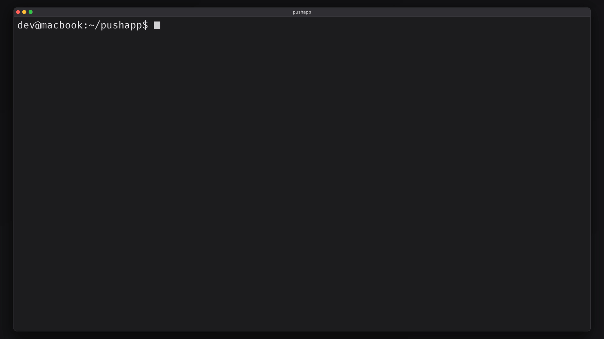

# @getmarrow/install



When AI agents can deploy, publish, merge or change production data, Marrow sits in front of them as the control layer: one policy across your agents, an approval before a risky action, and a receipt of what happened.

- Holds deploys and publishes for the owner's approval on Business and during the 30-day evaluation. On Team and Free, Marrow warns and the action still runs.
- Applies one policy across your agents, holds risky actions, and lets routine ones run.
- Keeps a receipt of what was checked and how it ended, without storing raw prompts or tool output.
- If Marrow is unreachable, hooks hold high-risk actions such as a git push, a publish, a deploy, or an API or cloud delete, and let routine actions run with a warning.
- In Claude Code, the free seatbelt refuses seven kinds of risky action on your machine with no account and no network call.

## What it is

`@getmarrow/install` is the default way to get Marrow working on your machine. It detects supported agents and projects, writes the configuration they need, runs a harmless self-test against your account, and prints a short summary that names the host to restart. After that, Marrow applies your policy before consequential actions and records a receipt of the outcome.

## Install

Create an account at [getmarrow.ai/signup](https://getmarrow.ai/signup), open **API keys** in the dashboard, and create an **agent key**. The full key is shown once; copy it before you close the dialog.

Save the key in the owner-only file `~/.marrow/env`, then run the installer:

```bash
mkdir -p ~/.marrow && chmod 700 ~/.marrow
${EDITOR:-nano} ~/.marrow/env          # one line: MARROW_API_KEY=<your_key>
chmod 600 ~/.marrow/env
npx -y @getmarrow/install@latest activate
```

The bare command `npx -y @getmarrow/install@latest` does the same thing: with no subcommand it also detects, writes the configuration, and runs the self-test. To preview without writing, run `npx -y @getmarrow/install@latest --dry-run`.

If you cannot write that file, load the key from your secret manager into the `MARROW_API_KEY` environment variable for this shell session, then run the same `activate` command. Keep the key off the command line; it lands in your shell history.

With no key, `activate` and the bare command print what to do and exit 2 before writing anything. `--dry-run`, `doctor`, and `uninstall` need no key.

If you already installed the Claude Code plugin, do not run `activate`. Put the key in `~/.marrow/env` and run `/reload-plugins` instead. See [Start here](https://getmarrow.ai/docs/#start-here).

## First run

Restart the host the summary names (for example, "Restart Claude Code"), then check:

```bash
npx -y @getmarrow/install@latest doctor --self-test
```

`doctor` already runs the same server self-test. A passing check means Marrow is working on this machine. For what a healthy first run shows, see [First Hour](https://getmarrow.ai/docs/#first-hour).

## Requirements

- Node.js 18 or later
- An agent key in `~/.marrow/env` (or `MARROW_API_KEY` in the environment) for plan-based checks, approvals, and proof. The installer ignores `~/.marrow/env` unless only you can read it (`chmod 700 ~/.marrow && chmod 600 ~/.marrow/env`).
- Native Windows is not supported yet. Use WSL.
- Cursor support is being fixed and does not work reliably yet. See [Start here](https://getmarrow.ai/docs/#start-here).

## Documentation

The docs at [getmarrow.ai/docs](https://getmarrow.ai/docs/) are the source of truth for detailed information.

- [Start here](https://getmarrow.ai/docs/#start-here): first-time setup, plans, and the Claude Code plugin path
- [First Hour](https://getmarrow.ai/docs/#first-hour): what a healthy first run shows
- [Get your API key](https://getmarrow.ai/docs/#get-api-key) and [API key management](https://getmarrow.ai/docs/#api-key-management)
- [Universal installer](https://getmarrow.ai/docs/#quickstart-installer): configuration, hooks, key files, `govern`, and `run`
- [Update Marrow](https://getmarrow.ai/docs/#update-marrow) and [Keeping Marrow current](https://getmarrow.ai/docs/#keeping-marrow-current)
- [Uninstall](https://getmarrow.ai/docs/#uninstall)
- [Govern an action](https://getmarrow.ai/docs/#govern-an-action), [Before-action intervention](https://getmarrow.ai/docs/#runtime-intervention), and [Action permit enforcement](https://getmarrow.ai/docs/#action-permit-enforcement): policies, gates, and permits
- [Govern TUI](https://getmarrow.ai/docs/#govern-tui) and [Fleet Operator TUI](https://getmarrow.ai/docs/#fleet-operator-tui)
- [Trust and data boundaries](https://getmarrow.ai/docs/#trust-boundaries), [Trust Center](https://getmarrow.ai/trust/), and [Security](https://getmarrow.ai/security)
- [Changelog](https://getmarrow.ai/docs/#changelog) and [Pricing](https://getmarrow.ai/pricing)
- [Marrow for Claude Code](https://getmarrow.ai/marrow-for-claude-code) and [MCP setup](https://getmarrow.ai/docs/#quickstart-mcp)

Related packages: [@getmarrow/sdk](https://www.npmjs.com/package/@getmarrow/sdk) and [@getmarrow/mcp](https://www.npmjs.com/package/@getmarrow/mcp).

## Uninstall

```bash
npx -y @getmarrow/install@latest uninstall          # preview: lists what would be removed, changes nothing
npx -y @getmarrow/install@latest uninstall --yes    # removes Marrow's own entries
```

Your own hooks and settings are kept. See [Uninstall](https://getmarrow.ai/docs/#uninstall) for details, including `--all`.

## License

MIT

## Support

- Docs: [getmarrow.ai/docs](https://getmarrow.ai/docs/)
- Issues: [getmarrow/marrow-install](https://github.com/getmarrow/marrow-install/issues)
- Status: [getmarrow.ai/status](https://getmarrow.ai/status/)
